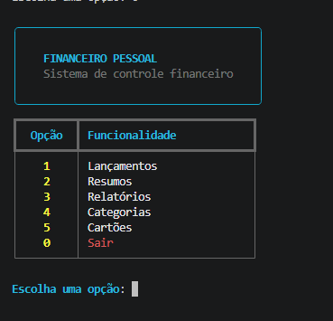
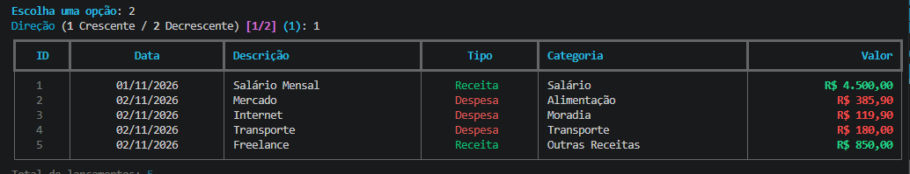
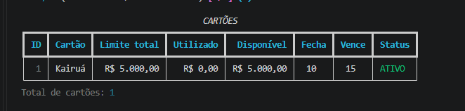

# Kairuá

**Suas finanças, no tempo certo.**

Sistema de gestão financeira pessoal desenvolvido em **Python**, com persistência de dados em **SQLite** e interface de terminal aprimorada com **Rich**.

O Kairuá nasceu como um projeto pessoal de desenvolvimento de software, com o objetivo de centralizar o gerenciamento de receitas, despesas, cartões de crédito, faturas, parcelamentos e compromissos recorrentes.

O nome é inspirado no conceito grego de *kairós*, associado ao momento oportuno, combinado com uma sonoridade brasileira.

> **Status:** Em desenvolvimento ativo. O projeto funciona por meio de uma interface de linha de comando (CLI) e está passando por melhorias de usabilidade, organização e apresentação dos dados.

## Funcionalidades

### Gestão de lançamentos
- Cadastro de receitas e despesas.
- Organização por categorias.
- Consulta e filtragem por período e categoria.
- Ordenação por diferentes critérios.

### Cartões de crédito
- Cadastro e gerenciamento de cartões.
- Acompanhamento de limites.
- Registro de compras.
- Controle de faturas e vencimentos.
- Compras parceladas.

### Parcelamentos e recorrências
- Cadastro de compromissos parcelados.
- Acompanhamento do progresso dos pagamentos.
- Gerenciamento de receitas e despesas recorrentes.
- Controle de status e ocorrências.

### Relatórios e resumos
- Resumo financeiro geral e mensal.
- Consultas de lançamentos e compromissos.
- Relatórios por categoria e período.
- Exportação de informações em CSV.

### Experiência de uso
- Menus interativos no terminal.
- Tabelas formatadas com Rich.
- Ordenação por campos numéricos, textuais e datas.
- Preferências de ordenação armazenadas localmente.

## Tecnologias utilizadas

| Tecnologia | Finalidade |
|---|---|
| Python | Linguagem principal |
| SQLite | Banco de dados relacional local |
| Rich | Interface e apresentação no terminal |
| Git | Versionamento do código |
| GitHub | Hospedagem do repositório |

## Estrutura do projeto

```text
kairua/
├── app.py
├── banco.py
├── utils.py
├── auditoria_financeira.py
├── auditoria_parcelas.py
├── auditoria_composicao.py
├── corrigir_vencimentos.py
├── requirements.txt
├── .gitignore
└── README.md
```

**Arquivos principais:**

- `app.py`: menus, interface e operações do sistema.
- `banco.py`: operações e estruturas do banco de dados.
- `utils.py`: funções auxiliares, formatação e ordenação.

Os demais scripts são ferramentas auxiliares de auditoria e manutenção desenvolvidas durante a evolução do projeto.

## Instalação e execução

### Pré-requisitos

- Python 3
- pip
- Git

### 1. Clonar o repositório

```bash
git clone https://github.com/aquilesportela/kairua.git
cd kairua
```

### 2. Criar um ambiente virtual

```bash
python -m venv .venv
```

### 3. Ativar o ambiente virtual

No Windows, utilizando PowerShell:

```powershell
.\.venv\Scripts\Activate.ps1
```

### 4. Instalar as dependências

```bash
pip install -r requirements.txt
```

### 5. Executar o sistema

```bash
python app.py
```

O aplicativo possui rotinas de criação das tabelas SQLite durante a inicialização.

**Nota:** a instalação em um ambiente totalmente novo ainda está em validação. Recomenda-se utilizar dados de teste ao experimentar o sistema.


## Demonstração

As imagens apresentam a interface atual do Kairuá, utilizando
um ambiente isolado com dados fictícios.

### Menu principal



### Controle de lançamentos



### Gerenciamento de cartões



## Privacidade e armazenamento

O Kairuá utiliza armazenamento local em SQLite.

Arquivos de banco de dados, backups, preferências locais e ambientes virtuais são excluídos do versionamento por meio do `.gitignore`.

O repositório disponibiliza o código-fonte, não os registros financeiros pessoais utilizados durante o desenvolvimento.

## Roadmap

- [x] Implementar gerenciamento de lançamentos e categorias.
- [x] Implementar cartões de crédito e faturas.
- [x] Implementar parcelamentos e recorrências.
- [x] Adicionar menus e tabelas com Rich.
- [x] Implementar preferências persistentes de ordenação.
- [ ] Concluir a modernização das listagens e relatórios.
- [ ] Aprimorar dashboards e indicadores financeiros.
- [ ] Validar a instalação em ambiente limpo.
- [ ] Expandir os testes automatizados.
- [ ] Adicionar capturas de tela e demonstrações.

## Objetivo do projeto

O Kairuá também funciona como um projeto de portfólio, demonstrando a aplicação prática de conceitos de:

- Programação em Python.
- Modelagem e manipulação de bancos de dados relacionais.
- Organização e manutenção de código.
- Implementação de regras de negócio.
- Versionamento com Git.
- Evolução incremental de software.

## Autor

Desenvolvido por [Aquiles Portela](https://github.com/aquilesportela).

---

*Kairuá — Suas finanças, no tempo certo.*